# Biblia RV1960 — React Native

App móvil **no nativa** hecha con React Native y Expo que consulta la Biblia Reina-Valera 1960 en la API REST de [bolls.life](https://bolls.life). Tiene dos modos de consulta: **capítulo completo** (libro + capítulo) y **versículo único** (libro + capítulo + versículo).

Materia: Tecnologías de desarrollo de software. Laboratorio guiado "App de consulta bíblica con React Native".

## Ejecutar

```bash
npm install
npx expo start
```

Abre la app con Expo Go (escaneando el QR) o en un emulador de Android con la tecla `a`.

## Estructura

```
App.js                          pantalla principal
src/api/biblia.js               acceso a la API (libros, capítulo, versículo)
src/components/                 FormularioConsulta, SelectorLibro, ListaVersiculos, TarjetaVersiculo
src/utils/texto.js              limpia las etiquetas HTML del texto
```

## Capturas por modo

| Capítulo completo (Juan 3) | Versículo único (Juan 3:16) |
|---|---|
| 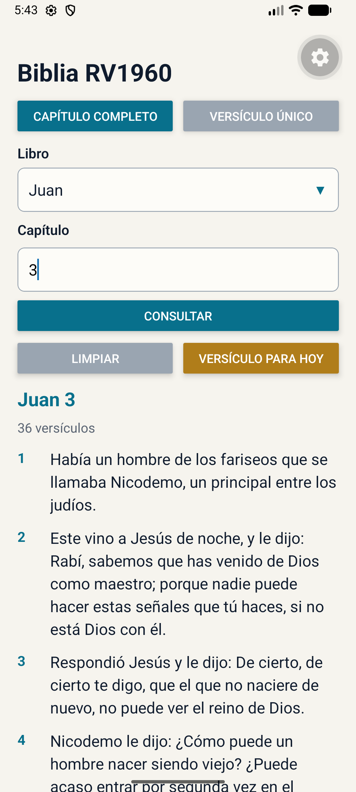 | 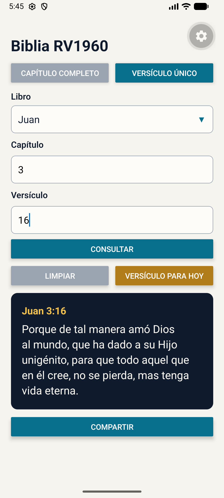 |

## Pruebas (pasos 17, 19 y 20)

| Prueba | Resultado esperado | Captura |
|---|---|---|
| Abrir la app | Indicador de carga y después el formulario | 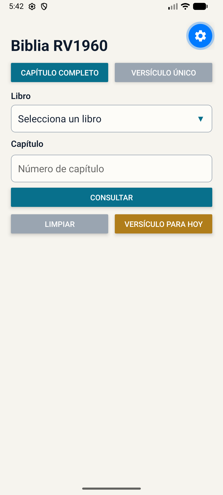 |
| Abrir el selector de libros | Lista de los 66 libros, de Génesis a Apocalipsis | 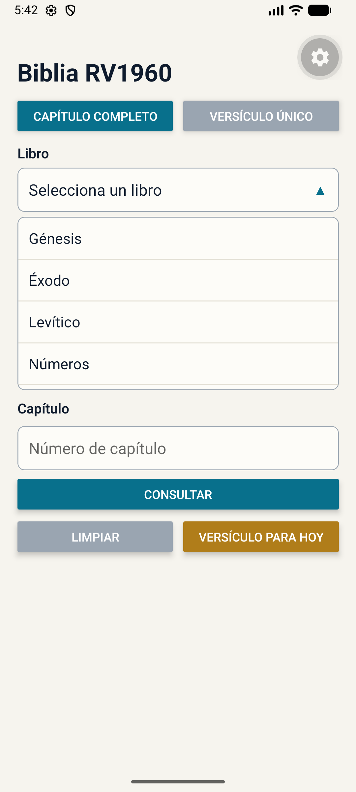 |
| Capítulo completo: Juan 3 | Lista con 36 versículos |  |
| Capítulo completo: Salmos 23 | 6 versículos sin etiquetas `<br>` | 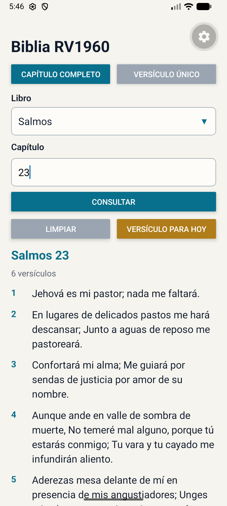 |
| Versículo único: Juan 3:16 | Tarjeta con el texto de Juan 3:16 |  |
| Versículo único: Juan 3:99 | Mensaje rojo: no se encontró el texto | 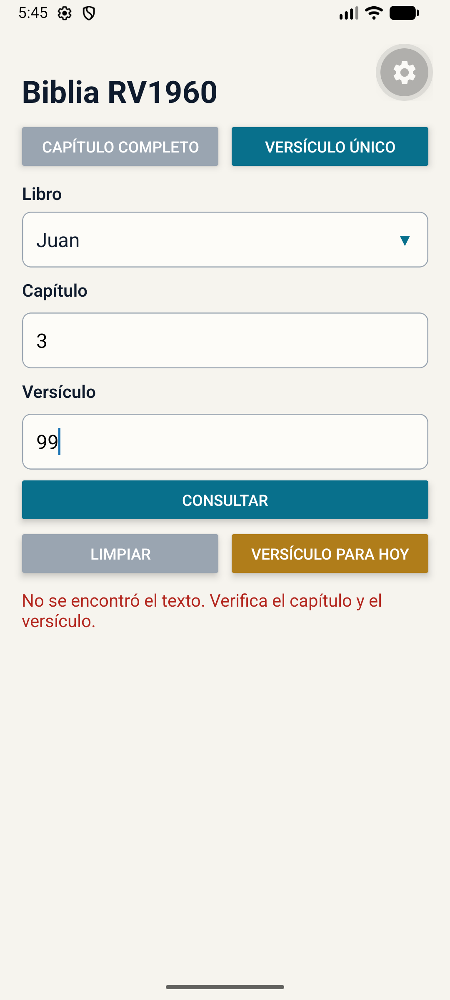 |
| Capítulo inválido: Juan 50 | Mensaje de validación: "Juan tiene 21 capítulos." | 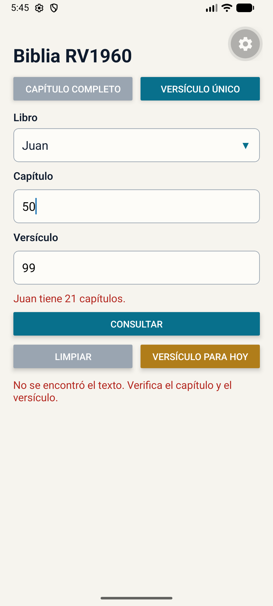 |
| Modo avión y consultar | Mensaje rojo de error; la app no se cierra | 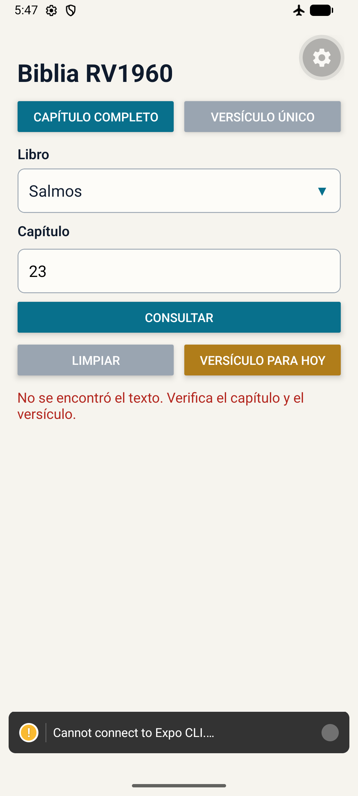 |

En la terminal de Expo no aparecieron mensajes rojos ni amarillos.

## Retos adicionales

| Reto | Captura |
|---|---|
| Botón **Limpiar**: borra el formulario y los resultados | 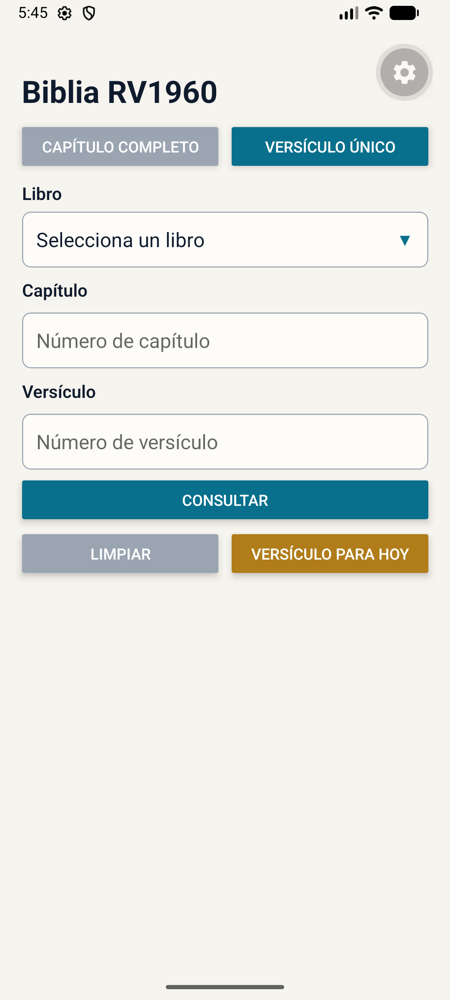 |
| **Conteo de versículos** debajo del título del capítulo |  |
| Botón **Compartir** con el componente `Share` | 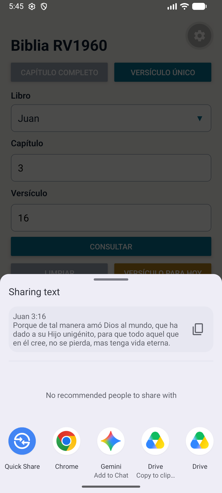 |
| **Versículo para hoy**: libro al azar y su primer versículo | 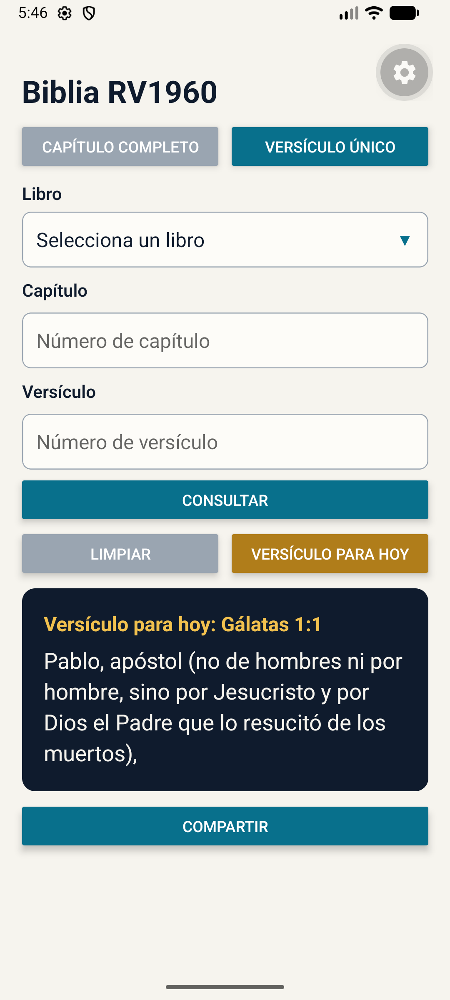 |
